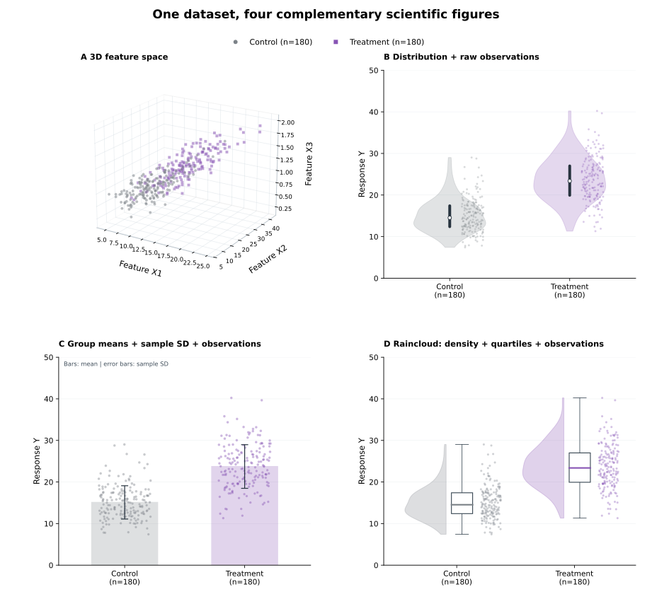

# Scientific Figure Workbench

**Codex 科研绘图 Skill｜科研问题 → 图型选择 → 数据校验 → 出图 → 独立审计 → 可复现交付**

不再只给 AI 一句「把图画好看」。这个独立 Skill 让 Codex 先检查观测单位、数据结构、缺失值和分组，再选择适合科学问题的图型。默认采用**石墨灰 × 柔紫**的朴素期刊风，但颜色可自定义。



> **示例声明：**上图使用 `make_synthetic_demo.py` 固定随机种子生成的教学模拟数据（每组 180 行），并非真实实验/临床数据。所有统计量由示例 CSV 计算得出；模拟数据只用于演示绘图流程。

## 它能做什么

- **先选图型**：依据研究问题选择散点、分组趋势、分布图或适合 CFD/风洞数据的图，不盲目强制四宫格。
- **四图示例**：3D 散点（同时输出三个正交二维投影）、小提琴图＋原始点、均值±样本 SD 柱状散点、雨云图。
- **科学底线**：检测缺失/非法值；不擅自删点、补值、造单位、造显著性；不把 KDE 的平滑峰解释为真实子群。
- **期刊级导出**：PNG（默认 300 DPI）、SVG（尽可能保留可编辑文字）、矢量 PDF、完整 Python 源码与 JSON 审计记录。
- **结果复核**：独立重新计算样本量、均值、SD、中位数、四分位数、极值和文件校验值。

## 安装到 Codex

推荐在 macOS / Linux 终端直接安装到个人 Skills 目录：

```bash
mkdir -p ~/.agents/skills
git clone https://github.com/Wendy-skill/scientific-figure-workbench.git ~/.agents/skills/scientific-figure-workbench
python -m pip install -r ~/.agents/skills/scientific-figure-workbench/requirements.txt
```

将本仓库作为整个文件夹放在以下位置之一：

```text
~/.agents/skills/scientific-figure-workbench/                 # 全局使用
<your-project>/.agents/skills/scientific-figure-workbench/   # 仅当前项目
```

确保这个目录里直接包含 `SKILL.md`、`scripts/`、`references/` 和 `requirements.txt`。

```bash
python -m pip install -r requirements.txt
```

在 Codex 中说：

> 使用 `$scientific-figure-workbench`。先检查我提供的 CSV/Excel 数据的观测单位、变量类型、缺失值、分组和物理单位；根据研究问题推荐图型；绘制白底、石墨灰和柔紫配色的科研图。保留原始数据，严格标注 SD/SEM/CI 的定义；导出 PNG、SVG、PDF 和 Python 源码；运行独立验证，报告任何未通过检查的项目。

## 运行自带演示（无需真实科研数据）

```bash
python scripts/make_synthetic_demo.py --output examples/demo_experiment.csv --n 180
python scripts/plot_figures.py \
  --input examples/demo_experiment.csv --output examples/figure_output \
  --group 'Group' --x 'Feature X1' --y 'Feature X2' \
  --z 'Feature X3' --value 'Response Y' \
  --group-order Control,Treatment --ylim 0,50
python scripts/verify_output.py \
  --input examples/demo_experiment.csv --output examples/figure_output
```

导出目录包含 `figures/R01_overview` 到 `R06_orthogonal_views`，每个都有 `.png`、`.svg`、`.pdf`，以及 `analysis_audit.json` 和 `run_config.json`。

## 用自己的 CSV

```bash
python scripts/plot_figures.py \
  --input my_data.csv --output my_figures \
  --group Treatment --x FeatureA --y FeatureB --z FeatureC \
  --value Outcome --group-order Control,Treated \
  --unit 'g/m²' --colors '#7C8288,#8754B4'
```

**注意：**示例脚本要求两组、三个数值特征和一个数值响应，且每行是单条观测。若是重复测量、三个以上组别、缺乏足够观测或已有汇总统计，Codex 应依据 `SKILL.md` 和 `references/figure-decision-guide.md` **选择并修改适合的图**，而不是强行调用四图脚本。单位只在原始资料已明确时填写。默认不复制原始 CSV，保护私有实验数据。

## 验证

```bash
python -m unittest discover -s tests -v
```

更多细节参见 [`SKILL.md`](SKILL.md)、[`references/figure-decision-guide.md`](references/figure-decision-guide.md) 和 [`references/quality-checklist.md`](references/quality-checklist.md)。

## Scope / Limitations

This Skill guides reproducible scientific visualisation; it is not a statistical inference engine, clinical diagnostic model or CFD solver. Sample plots use **synthetic teaching data**. SVG text editability depends on fonts and downstream editors. Exporting data snapshots is opt-in. No causal, clinical or significance claims are made by the example.